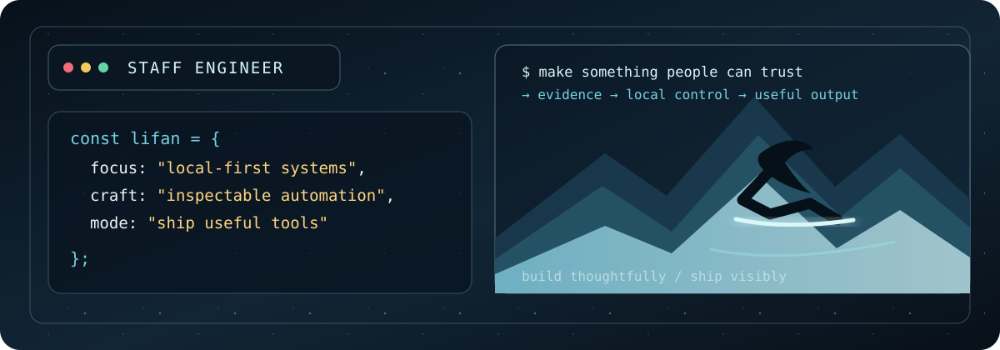

  

# Lifan

**Staff Engineer @ Google** · local-first products · agent systems · agent evaluation · self-improving agent harnesses

  <a href="#main-focuses">Main focuses</a> ·
  <a href="#selected-builds">Selected builds</a> ·
  <a href="#how-i-build">How I build</a>

<h2 id="main-focuses">Main Focuses</h2>

<table>
  <tr>
    <td width="25%" valign="top"><strong>Local-first products</strong> Useful tools that keep personal data and decisions close to the user.</td>
    <td width="25%" valign="top"><strong>Agent systems</strong> Durable workflows, tools, and control surfaces for coding agents.</td>
    <td width="25%" valign="top"><strong>Agent evaluation</strong> Evidence, benchmarks, and review loops that make capability visible.</td>
    <td width="25%" valign="top"><strong>Self-improving harnesses</strong> Agent infrastructure that learns from its own work without hiding the trail.</td>
  </tr>
</table>

Build principle: evidence → local control → human review → shipped artifact.

## Selected Builds

<table>
  <tr>
    <td width="50%" valign="top">
      <a href="https://github.com/lifan-builds/flyingpig"><strong>Flying Pig AI</strong></a> 
      Supervised AI customer-service advocate that pauses at structured decision checkpoints before consequential actions.
    </td>
    <td width="50%" valign="top">
      <a href="https://github.com/lifan-builds/mychart-cli"><strong>mychart-cli</strong></a> 
      Public local-first CLI for exporting patient-owned MyChart records through a Chrome/Puppeteer harness.
    </td>
  </tr>
  <tr>
    <td width="50%" valign="top">
      <a href="https://github.com/lifan-builds/perks-reminder"><strong>Perks Reminder</strong></a> 
      Open-source benefits tracker for welcome bonuses, annual fees, recurring credits, certificates, and loyalty expirations.
    </td>
    <td width="50%" valign="top">
      <a href="https://github.com/lifan-builds/snow-deal"><strong>FreshPowder</strong></a> 
      Ski and snowboard deal aggregator tracking current and historical deals across North American retailers.
    </td>
  </tr>
  <tr>
    <td width="50%" valign="top">
      <a href="https://github.com/lifan-builds/castforge"><strong>CastForge</strong></a> 
      Source-to-podcast automation framework with reusable pipeline stages, audio integrations, publishing, and validation.
    </td>
    <td width="50%" valign="top">
      <a href="https://github.com/lifan-builds/nitan-podcast"><strong>Nitan Podcast</strong></a> 
      Weekly Chinese podcast generated from USCardForum discussions and shipped through RSS and podcast platforms.
    </td>
  </tr>
  <tr>
    <td width="50%" valign="top">
      <a href="https://github.com/lifan-builds/context-harness"><strong>Context Harness</strong></a> 
      Tiny filesystem memory layer for coding agents: durable context files, companion skills, and local scripts.
    </td>
    <td width="50%" valign="top">
      <a href="https://github.com/lifan-builds/agent-nexus"><strong>Agent Nexus</strong></a> 
      Manifest-driven deployment of skills, hooks, and MCP servers across modern coding environments.
    </td>
  </tr>
  <tr>
    <td width="50%" valign="top">
      <a href="https://github.com/lifan-builds/cpa-phoenix"><strong>CPA Phoenix</strong></a> RECENT 
      CLIProxyAPI plugin for igniting fresh Codex accounts and supervising invalid-account recovery through a preserved repair queue.
    </td>
    <td width="50%" valign="top">
      <a href="https://github.com/lifan-builds/ai-builder-brief"><strong>AI Builder Brief</strong></a> RECENT 
      Source-linked AI developments turned into evidence-gated review artifacts, with the public feed held closed while editorial policy is tuned.
    </td>
  </tr>
  <tr>
    <td width="50%" valign="top">
      <strong>Continuity</strong> LOCAL · IN PROGRESS 
      Workflow, evaluation, repair, checkpoint, and human-gate control plane for a local agent-first research system.
    </td>
    <td width="50%" valign="top">
      <strong>OpenMuseCall</strong> LOCAL · IN PROGRESS 
      Open, supervised calling agent prototype for authorized Mac-to-iPhone cellular calls, with explicit control and safety gates.
    </td>
  </tr>
</table>

## How I Build

  <code>source</code> → <code>build</code> → <code>evaluate</code> → <code>inspect</code> → <code>improve</code> → <code>ship</code>

I run an evaluation loop: turn the goal into a repeatable check, inspect failures and evidence, improve the system, then run the check again before shipping.

Claude Code and Codex are my primary agent tools. I use shell, browser, test, and review tools around them, with Trellis as the primary framework for my agent harnesses.

I care about systems that leave a trail: what happened, what was proposed, what a person approved, and what finally shipped.

## Tools I Reach For

  
  
  
  
  

  
<strong>More about the portfolio</strong>

   
  The through-line is practical automation with visible boundaries: local data when it should stay local, source trails when decisions matter, and human checkpoints before consequential actions.

  <a href="https://x.com/LifanBuilds">Say hello on X</a> ·
  <a href="https://github.com/lifan-builds?tab=repositories">Browse all repositories</a>

