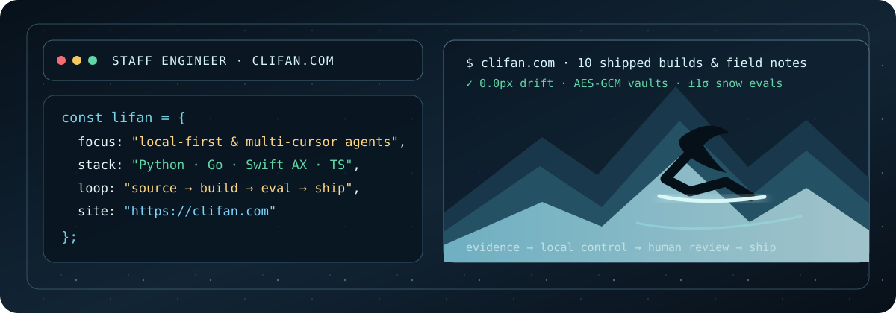

  

# Lifan

**Builder @ Google** · local-first products · agent systems · agent evaluation · self-improving agent harnesses

  <a href="https://clifan.com">clifan.com</a> ·
  <a href="#main-focuses">Main focuses</a> ·
  <a href="#selected-builds">Selected builds</a> ·
  <a href="https://clifan.com/journal/">Writing &amp; 70 daily briefs</a> ·
  <a href="#how-i-build">How I build</a>

<h2 id="main-focuses">Main Focuses</h2>

<table>
  <tr>
    <td width="25%" valign="top"><strong>Local-first products</strong> Useful tools that keep personal data and decisions close to the user.</td>
    <td width="25%" valign="top"><strong>Agent systems</strong> Durable workflows, tools, and control surfaces for coding agents.</td>
    <td width="25%" valign="top"><strong>Agent evaluation</strong> Evidence, benchmarks, and review loops that make capability visible.</td>
    <td width="25%" valign="top"><strong>Self-improving harnesses</strong> Agent infrastructure that learns from its own work without hiding the trail.</td>
  </tr>
</table>

Build principle: evidence → local control → human review → shipped artifact.

## Selected Builds

<table>
  <tr>
    <td width="50%" valign="top">
      <a href="https://clifan.com/faster-mac-use/"><strong>Faster Mac Use (fmu)</strong></a> NEW 
      Background-first, multi-cursor browser &amp; native macOS computer-use engine (0.0 px cursor drift, 268-tok schema, 1,290–2,024 tok vs. 231,125 in <code>@playwright/mcp</code>, 1,510 tok / 326 ms 3-agent swarm; <a href="https://clifan.com/faster-mac-use/">interactive benchmarks</a> · <a href="https://pypi.org/project/faster-mac-use/">PyPI</a> · <a href="https://github.com/lifan-builds/faster-mac-use">repo</a>).
    </td>
    <td width="50%" valign="top">
      <a href="https://clifan.com/agent-autofill/"><strong>Agent Autofill</strong></a> NEW 
      Local-first personal data broker for AI agents with scoped credential/profile access and explicit human approval gates (<a href="https://clifan.com/agent-autofill/">overview</a> · <a href="https://clifan.com/agent-autofill/demo/">interactive demo</a> · <a href="https://pypi.org/project/agent-autofill/">PyPI</a> · <a href="https://github.com/lifan-builds/agent-autofill">repo</a>).
    </td>
  </tr>
  <tr>
    <td width="50%" valign="top">
      <a href="https://clifan.com/quotaswitch/"><strong>QuotaSwitch</strong></a> NEW 
      Unified quota-driven multi-account switcher, 30s rotator, and local <code>:18455/v1</code> gateway for Google Antigravity (<code>agy</code>) and OpenAI Codex (<a href="https://clifan.com/quotaswitch/">overview</a> · <a href="https://clifan.com/journal/#codex-quota-worker">workflow note</a> · <a href="https://github.com/lifan-builds/quotaswitch">repo</a>).
    </td>
    <td width="50%" valign="top">
      <a href="https://clifan.com/close-snow/"><strong>CloseSnow</strong></a> NEW 
      Free 15-day mountain snow forecaster across 120 Ikon &amp; Epic ski resorts with calibrated <code>±1σ</code> error bars, 3D Cobb/Alcott SLR, and 41 live USDA SNOTEL stations — <code>2.37&quot;</code> storm MAE vs. OpenSnow <code>4.01&quot;</code> (<a href="https://clifan.com/close-snow/">overview</a> · <a href="https://close-snow.clifan.com/">live app</a> · <a href="https://close-snow.clifan.com/?view=methodology">accuracy lab</a>).
    </td>
  </tr>
  <tr>
    <td width="50%" valign="top">
      <a href="https://clifan.com/perks-reminder/"><strong>Perks Reminder</strong></a> 
      Open-source benefits tracker for welcome bonuses, annual fees, recurring credits, certificates, and loyalty expirations (<a href="https://clifan.com/perks-reminder/">overview</a> · <a href="https://www.perks-reminder.com/">live app</a> · <a href="https://github.com/lifan-builds/perks-reminder">repo</a>).
    </td>
    <td width="50%" valign="top">
      <a href="https://clifan.com/freshpowder/"><strong>FreshPowder</strong></a> 
      Ski and snowboard deal aggregator tracking current and historical deals across 28 North American retailers (<a href="https://clifan.com/freshpowder/">overview</a> · <a href="https://freshpowder.clifan.com/">live app</a> · <a href="https://github.com/lifan-builds/clearcut">repo</a>).
    </td>
  </tr>
  <tr>
    <td width="50%" valign="top">
      <a href="https://clifan.com/foliofen-cli/"><strong>Foliofen CLI</strong></a> 
      Public local-first CLI for exporting patient-owned MyChart records through a Chrome/Puppeteer harness (<a href="https://clifan.com/foliofen-cli/">overview</a> · <a href="https://www.npmjs.com/package/@lifan-builds/foliofen-cli">npm</a> · <a href="https://github.com/lifan-builds/foliofen-cli">repo</a>).
    </td>
    <td width="50%" valign="top">
      <a href="https://clifan.com/ai-builder-brief/"><strong>AI Builder Brief</strong></a> RECENT 
      Source-linked AI developments turned into evidence-gated review artifacts (<a href="https://clifan.com/ai-builder-brief/">overview</a> · <a href="https://clifan.com/journal/ai-builder-brief/">daily briefs</a> · <a href="https://github.com/lifan-builds/ai-builder-brief">repo</a>).
    </td>
  </tr>
  <tr>
    <td width="50%" valign="top">
      <a href="https://clifan.com/castforge/"><strong>CastForge</strong></a> 
      Source-to-podcast automation framework with reusable pipeline stages, audio integrations, publishing, and validation (<a href="https://clifan.com/castforge/">overview</a> · <a href="https://pypi.org/project/castforge/">PyPI</a> · <a href="https://github.com/lifan-builds/castforge">repo</a>).
    </td>
    <td width="50%" valign="top">
      <a href="https://clifan.com/nitan-podcast/"><strong>Nitan Podcast</strong></a> 
      Weekly Chinese podcast generated from USCardForum discussions and shipped through RSS and podcast platforms (<a href="https://clifan.com/nitan-podcast/">listen</a> · <a href="https://github.com/lifan-builds/nitan-podcast">repo</a>).
    </td>
  </tr>
  <tr>
    <td width="50%" valign="top">
      <a href="https://clifan.com/echoframe/"><strong>EchoFrame</strong></a> NEW 
      Turn an Amazon Echo Show (Vega OS &amp; Fire OS) into an ad-free, zero-crop AI-curated iPhone photo frame with <code>1600×960</code> portrait diptychs and Juno DNS sinkholing (<a href="https://clifan.com/echoframe/">overview</a> · <a href="https://github.com/lifan-builds/echoframe">repo</a>).
    </td>
    <td width="50%" valign="top">
      <a href="https://github.com/lifan-builds/context-harness"><strong>Context Harness</strong></a> 
      Tiny filesystem memory layer for coding agents: durable context files, companion skills, and local scripts.
    </td>
  </tr>
</table>

## How I Build

  <code>source</code> → <code>build</code> → <code>evaluate</code> → <code>inspect</code> → <code>improve</code> → <code>ship</code>

I run an evaluation loop: turn the goal into a repeatable check, inspect failures and evidence, improve the system, then run the check again before shipping.

Antigravity, Codex, and Claude Code are my primary agent surfaces, wired through portable skills, background computer-use, and deterministic evaluation gates.

I care about systems that leave a trail: what happened, what was proposed, what a person approved, and what finally shipped.

## Tools I Reach For

  
  
  
  
  
  
  
  
  

  
<strong>More about the portfolio (clifan.com)</strong>

   
  The through-line across all 10 hosted builds on <a href="https://clifan.com">clifan.com</a> is practical automation with visible boundaries: local data when it should stay local, repeatable evaluation harnesses before claims ship, and human checkpoints before consequential external actions.

  <a href="https://clifan.com">Visit clifan.com</a> ·
  <a href="https://x.com/LifanBuilds">Say hello on X</a> ·
  <a href="https://github.com/lifan-builds?tab=repositories">Browse all repositories</a>

